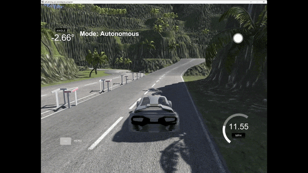
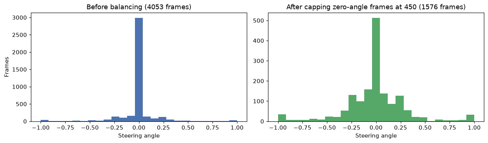
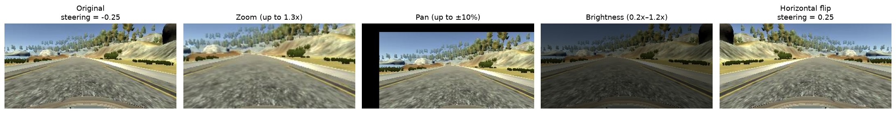
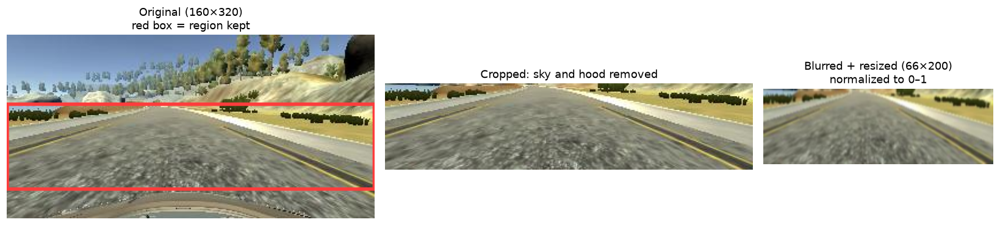

# Behavioral Cloning: End-to-End Self-Driving in Simulation

A convolutional neural network that learns to steer a car directly from camera images. The model is trained on recorded human driving, then drives the car autonomously in the Udacity self-driving car simulator through a live Socket.IO connection.

<!-- Add a demo GIF here once recorded, e.g.:

-->

## How it works

```
camera frame → preprocess → CNN → steering angle → simulator
```

1. **Training (`main.py`):** loads recorded driving data, balances it, augments it on the fly, and trains a CNN to predict the steering angle for each image.
2. **Driving (`drive.py`):** runs a Socket.IO server that receives live camera frames from the simulator, preprocesses each one the same way as in training, predicts a steering angle, and sends it back along with a throttle value.

## Data

Each recorded frame has three camera images (center, left, right) and the steering angle at that moment.

**Balancing.** Most driving is straight, so 72% of frames had a steering angle of exactly 0. Left as-is, the model learns to always go straight. Zero-angle frames are randomly capped at 450:



**Using all three cameras.** The left and right images are used as extra training samples, with the steering angle shifted by ±0.15. This teaches the model how to recover when it drifts toward the edge of the road, and triples the training data.

## Augmentation

During training, each image has a 50% chance of each augmentation, applied independently. Every epoch sees freshly randomized images, which helps the model generalize instead of memorizing the track. Validation images are not augmented.



Flipping mirrors the image left to right, so the steering angle's sign is flipped too.

## Preprocessing

Every image, in training and while driving, goes through the same steps:



1. **Crop** to rows 60–135, removing the sky and the car's hood, which carry no steering information.
2. **Gaussian blur** (3×3 kernel) to reduce noise.
3. **Resize** to 66×200, the input size of the NVIDIA architecture.
4. **Normalize** pixel values from 0–255 to 0–1.

## Model

Based on NVIDIA's [End to End Learning for Self-Driving Cars](https://arxiv.org/abs/1604.07316) architecture:

| Layer | Details | Output shape |
|---|---|---|
| Input | preprocessed RGB image | 66 × 200 × 3 |
| Conv2D | 24 filters, 5×5, stride 2, ELU | 31 × 98 × 24 |
| Conv2D | 36 filters, 5×5, stride 2, ELU | 14 × 47 × 36 |
| Conv2D | 48 filters, 5×5, stride 2, ELU | 5 × 22 × 48 |
| Conv2D | 64 filters, 3×3, ELU | 3 × 20 × 64 |
| Conv2D | 64 filters, 3×3, ELU | 1 × 18 × 64 |
| Flatten | | 1152 |
| Dense | 100, ELU | 100 |
| Dense | 50, ELU | 50 |
| Dense | 10, ELU | 10 |
| Dense | output, no activation | 1 (steering angle) |

**Training:** Adam optimizer, mean squared error loss (steering is a regression problem), batch size 100, 10 epochs, 80/20 train/validation split. Batches come from a Python generator, so augmented images are created as needed instead of all being held in memory.

<!-- Add the loss plot here, e.g.:

-->

## Running it

Requires Python 3.11.

```bash
python -m venv venv
venv\Scripts\activate          # Windows; on macOS/Linux: source venv/bin/activate
pip install -r requirements.txt
```

**Get the data:** clone the [dataset](https://github.com/rslim087a/track) into a folder named `track/` in the project root.

**Train:**
```bash
python main.py
```
This saves the trained model as `model.keras`.

**Drive:**
1. Download the [Udacity simulator](https://github.com/udacity/self-driving-car-sim) (Term 1).
2. Run `python drive.py` and wait for `wsgi starting up on http://0.0.0.0:4567`.
3. Open the simulator, choose the lake track, and click **Autonomous Mode**.

## Project structure

```
main.py            data loading, balancing, augmentation, training
drive.py           Socket.IO server that drives the car with the trained model
model.keras        trained model
images/            figures used in this README
requirements.txt
```

## Tech

Python, TensorFlow / Keras, OpenCV, imgaug, NumPy, pandas, scikit-learn, Matplotlib, Flask, Socket.IO

## Acknowledgments

- Driving dataset from [rslim087a/track](https://github.com/rslim087a/track)
- Model architecture from NVIDIA, [End to End Learning for Self-Driving Cars](https://arxiv.org/abs/1604.07316) (Bojarski et al., 2016)
- [Udacity self-driving car simulator](https://github.com/udacity/self-driving-car-sim)
